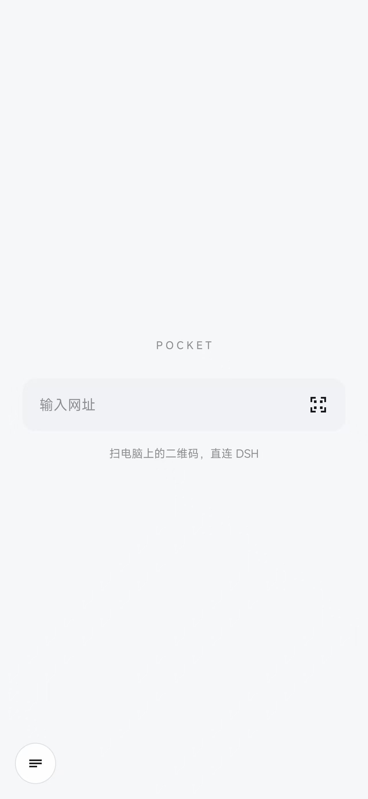
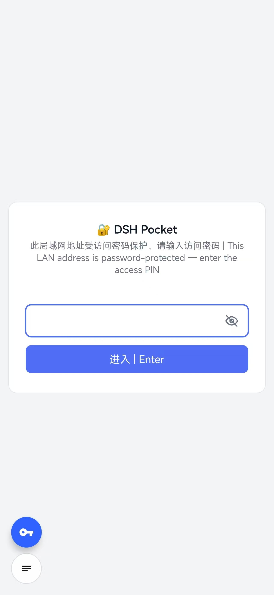
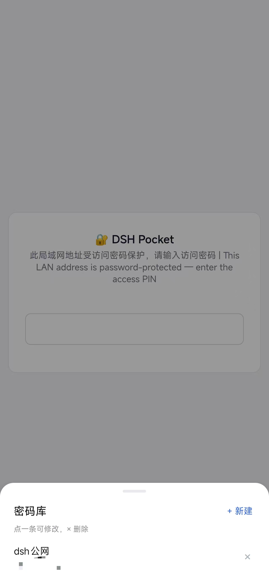
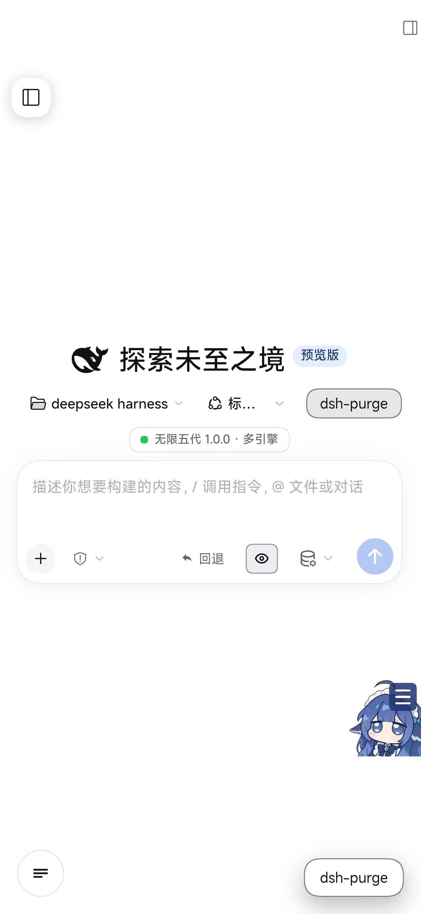

# Pocket

> 一个几乎没有界面的安卓浏览器。打开链接、扫二维码，剩下的地方全留给网页。

<p align="center">
  
  
  
  
</p>

---

## 为什么做这个

大多数手机浏览器打开就是一堆东西：地址栏、标签栏、书签栏、资讯流、推荐位……
真正想看的内容被挤到下面一小块。

Pocket 反过来：**整屏都是网页**。所有控件收在一个半透明小圆钮里，点了才出来。

它最开始是为了搭配 **dsh-pocket** 用的 —— 手机扫码连上电脑上的 DSH，
然后当成一个纯粹的 WebView 用。但本身也能当日常的「只读链接」浏览器。

---

## 特性

| | |
| --- | --- |
| 🖥 **零占位界面** | 网页铺满全屏，没有常驻地址栏、标签栏、工具栏 |
| ⚪ **一个按钮搞定一切** | 左下角 44dp 半透明圆钮，点开才有地址栏 + 最近打开 |
| 📷 **扫码直连** | 内置二维码扫描，扫到链接直接打开 |
| 🖼 **相册导入** | 扫不了屏幕上的码？截图后从相册选图识别 |
| 🔑 **密码库** | 存好 PIN，到密码页点一下蓝色钥匙，自动填入并提交 |
| 📱 **沉浸式全屏** | 状态栏、导航栏自动收起，边缘滑出后自动消失 |
| 🔗 **接收分享** | 从别的 App 分享链接过来可直接打开 |
| 🪶 **轻** | 约 300 KB，无第三方 SDK、无统计、无联网上报 |

**刻意不做的事**：搜索框、标签页、书签、下载管理、广告拦截、账号体系。
搜索请用专门的浏览器，这个不掺和。

---

## 界面

### 首页

```
        P O C K E T

   ┌─────────────────────┬────┐
   │  输入网址            │ ⛶  │   ← 扫码
   └─────────────────────┴────┘

     扫电脑上的二维码，直连 DSH

  ☰                            ← 左下角半透明小圆钮
```

### 点开那个小圆钮

面板从左下角浮出，包含：

- **地址栏** —— 当前网址，可直接改写跳转
- **后退 / 刷新 / 扫码**
- **最近打开** —— 最多 40 条，可单条删除或一键清空
- **🔑 密码库** —— 进入管理界面

点面板外的任意位置、或按返回键即收起。浏览网页时面板默认关闭，不挡内容。

---

## 下载

从 [Releases](../../releases) 下载最新的 `pocket-x.y.z.apk`，直接安装。

- 最低支持 **Android 8.0**（API 26）
- 需要**相机权限**才能扫码，其余功能不需要任何权限
- 安装时若提示「未知来源」，在系统设置里允许一次即可

> ⚠️ 用自签名证书打包，没有上架任何应用商店。介意的话请自行从源码构建。

---

## 配合 dsh-pocket 使用

1. 电脑上装好 dsh-pocket，在设置页的「手机访问」里会看到一个**局域网二维码**
2. 手机连**同一个 WiFi**
3. 打开 Pocket → 点输入框右边的 ⛶ → 扫那个二维码
4. 直接进入电脑上的 DSH 界面，不用手输密码

二维码里带的是 `http://<局域网IP>:<端口>/?token=<PIN>`，Pocket 打开后
pocket 服务会种一个 30 天有效的 HttpOnly cookie，之后重开也不用再扫。

人在外面要用的话，在 dsh-pocket 里开「公网访问」，扫公网那个二维码即可。

### 每次都要输 PIN 太烦？

用**密码库**：

1. 点 ☰ → 「🔑 密码库」→ 右上角「+ 新建」
2. 填名称（例如 `DSH-LAN`）和密码，保存
3. 之后打开任何**带密码框的页面**，左下角会自动多出一个**蓝色钥匙按钮**
4. 点钥匙 → 点那条记录 → 密码自动填入并提交

钥匙按钮只在「页面上确实存在可见密码框」**且**「密码库里至少有一条」时才出现，
不会在普通网页上碍眼。

---

## 从源码构建

不需要 Gradle，也不需要 Android Studio。只要有 **Android SDK** 和 **JDK**，
一条命令就能出包：

```bash
git clone <repo>
cd pocket
bash build.sh
# → dist/pocket-1.0.0.apk
```

### 依赖

| 项 | 要求 |
| --- | --- |
| Android SDK | 含 `build-tools` 与任一 `platforms/android-*` |
| JDK | 11 或以上（Android Studio 自带的 `jbr` 也行） |
| bash | Windows 上用 Git Bash / MSYS2 |
| ZXing core | 已随仓库附带 `libs/zxing-core.jar`；丢了跑 `bash fetch-deps.sh` |

SDK 和 JDK 会自动探测常见安装位置，探测不到再手动指定：

```bash
ANDROID_SDK_ROOT=/path/to/sdk JAVA_HOME=/path/to/jdk bash build.sh
```

### 可调的环境变量

| 变量 | 默认值 | 说明 |
| --- | --- | --- |
| `POCKET_VERSION` | `1.0.0` | 版本名 |
| `POCKET_VERSION_CODE` | `1` | 版本号（整数，升级必须递增） |
| `POCKET_BUILD_DIR` | `C:\pocket-build` / `/tmp/pocket-build` | 中间产物目录，**不能含空格** |
| `POCKET_KS_PASS` | `pocket-local` | 签名密钥口令 |
| `POCKET_BUILD_TOOLS` | 最新 | 指定 build-tools 版本 |
| `POCKET_PLATFORM` | 最新 | 指定 platform 版本 |

### 构建流程

```
aapt2 compile → aapt2 link → javac → d8 → jar uf → zipalign → apksigner
```

`build.sh` 首次运行会自动生成 `dist/pocket.keystore`（RSA 2048，有效期 10000 天）。

> **这个文件要自己保管好。** 换签名密钥后旧版本无法覆盖升级，必须先卸载再装。
> 它也已经在 `.gitignore` 里，不会被提交。

---

## 实现笔记

这部分是踩过的坑，写给想改代码的人。

### 极简界面：面板代替滑动

最早做的是底部可拖拽的 sheet，问题很明显：**它一直占着屏幕下方一块**，
网页内容被压住，而且滑出来的动作会误触。

改成左下角一个圆钮 + 点开浮出面板后，网页任何时候都是满屏的。
面板用 `alpha` + `translationY` 做 150ms 入场动画，不需要 `ValueAnimator` 改高度。

### 沉浸式全屏：两个方法，顺序不能错

```java
setupWindow();                 // 窗口属性 —— 必须在 setContentView 之前
setContentView(R.layout.activity_main);
hideBars();                    // 收栏 —— 必须在之后
```

- `setupWindow()` 设 `setDecorFitsSystemWindows(false)` 和
  `layoutInDisplayCutoutMode = ALWAYS`，让内容真正铺到系统栏和刘海底下
- `hideBars()` 用 `WindowInsetsController` + `BEHAVIOR_SHOW_TRANSIENT_BARS_BY_SWIPE`
  （滑出即隐，不是普通 `IMMERSIVE` 那种滑出来就赖着不走）
- **在 `setContentView` 之前调 `getInsetsController()` 会直接 NPE** —— 那时 DecorView 还没建
- 必须在 `onWindowFocusChanged` 里再收一遍：从相册、相机、权限弹窗回来时，
  系统会把状态栏恢复出来

**顶部一条和状态栏等高的黑边** 就是少了前两项造成的：栏藏了，但窗口还在给它留位置；
有刘海的机器还会额外被系统往下压一次。模拟器没刘海，所以这个问题只有真机才暴露。

### 扫码：系统 Camera + ZXing

不依赖任何相机库：

- 系统 `Camera` API 取 NV21 帧，预览尺寸限制在 720p 以内
- ZXing core 解 `QR_CODE`，开 `TRY_HARDER`
- `AtomicBoolean` 防重入，命中即回调并关闭预览
- 预览期间连续对焦，暗光下有手电筒

### 相册导入的两个坑

1. **系统图片选择器返回的 `content://` URI 只能稳定打开一次。**
   先读尺寸、再解码、最后读 EXIF 各开一次流，第二次就 `ENOENT`。
   所以整个文件先读成 `byte[]`（上限 64 MB），后面全走内存。
2. **不能和预览共用一个 `MultiFormatReader`。**
   `decodeWithState` 不是线程安全的，两边并发会互相破坏内部状态。
   相册解码时另建 reader，并用 `volatile boolean importing` 暂停预览解码。

另外按 1280 / 2048 / 4096 三档尺寸各试一遍（截图里二维码常只占一小块，
缩到固定尺寸容易糊掉），失败再试反色（深色主题截图）。

### 密码库：React 页面填值的坑

**直接 `el.value = x` 是没用的。** React / Vue 的受控组件感知不到，
下一次渲染会把值改回去。必须走原生 setter 并补派事件：

```js
Object.getOwnPropertyDescriptor(HTMLInputElement.prototype, 'value')
  .set.call(el, secret);
el.dispatchEvent(new Event('input',  { bubbles: true }));
el.dispatchEvent(new Event('change', { bubbles: true }));
```

再补 `keyup`，然后点提交。

**防误触**：只在「当前表单里恰好 1 个密码框」时才自动点 submit。
注册页那种「密码 + 确认密码」有两个框，就只填值不提交。

**存储**：密码字段用 Android Keystore 的 AES-256-GCM 加密后再 Base64 落盘，
密钥在 Keystore 里（`pocket_vault_key`），root 也导不出来。
名称和账号明文存 —— 列表要展示。

**层级**：密码库浮层必须 `elevation="20dp"`，否则左下角那个圆钮会浮在它上面，
把列表第一条盖住。

### 代码结构

```
src/com/littlesauce/pocket/
├── MainActivity.java   主界面：WebView、面板、沉浸式、密码库接线
├── ScanActivity.java   扫码页：相机预览、ZXing 解码、相册导入
├── VaultSheet.java     密码库浮层 + 注入用 JS
├── Vault.java          密码库存储（加密落盘）
├── Crypto.java         Android Keystore AES-GCM 封装
├── Store.java          最近打开记录
└── UrlFix.java         网址补全（局域网走 http，其余 https）
```

---

## 已知取舍

- **只认二维码**，不扫条形码 —— 用途就是扫连接码
- **没有搜索框** —— 故意的
- 最近记录纯本地 `SharedPreferences`，不跨设备同步
- WebView 开了 `usesCleartextTraffic`，因为局域网 DSH 走 http
- 目标 SDK 34，未适配 Android 15 的 edge-to-edge 强制行为（当前沉浸式方案已兼容）

## 隐私

- 不联网上报任何数据，没有统计 SDK、没有崩溃收集
- 不读取通讯录、短信、位置、存储（相册只通过系统选择器拿单张图）
- 最近记录和密码库都存在应用私有目录，卸载即清除
- 密码字段加密存储，密钥由 Android Keystore 保管

## 许可证

[MIT](LICENSE)

第三方依赖：[ZXing](https://github.com/zxing/zxing) core 3.5.3，Apache-2.0。
